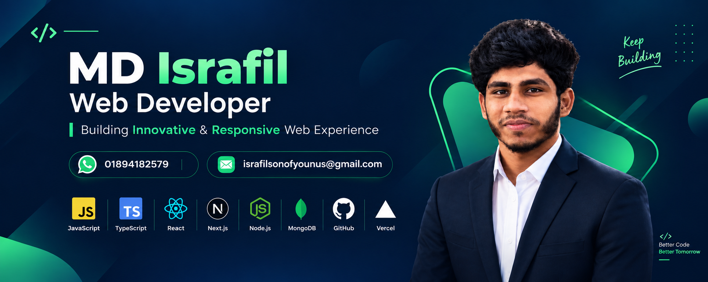

  

  <h1>Hi I'm Israfil 👋</h1>
  <h2>Full-Stack Web Developer</h2>

<h2>About Me:</h2>
I am a Full-Stack Web Developer dedicated to helping businesses and institutes solve digital challenges through responsive web development.    

What I Do:  
I build complete web solutions from initial concept to final deployment. My core focus is delivering clean code, blazing-fast performance, and a seamless user experience across all devices. 

How I Can Help You: 
• Developing business websites and high-converting landing pages  
• Building custom web platforms for institutes and organizations  
• Creating dynamic dashboards and web applications  
• Converting Figma designs into fully responsive, functional websites  

## 💻 Technical Skills

### Programming Languages

### Frontend Development

### Backend Development

### Database

### Tools & Platforms

📚 Currently Learning
YOUR LEARNING TOPIC 1
YOUR LEARNING TOPIC 2
YOUR LEARNING TOPIC 3

📊 GitHub Statistics

  

💻 Most Used Languages

  

🔥 Contribution Streak

  

📈 Contribution Graph

  

